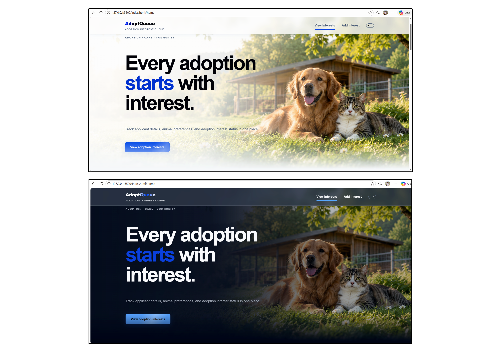
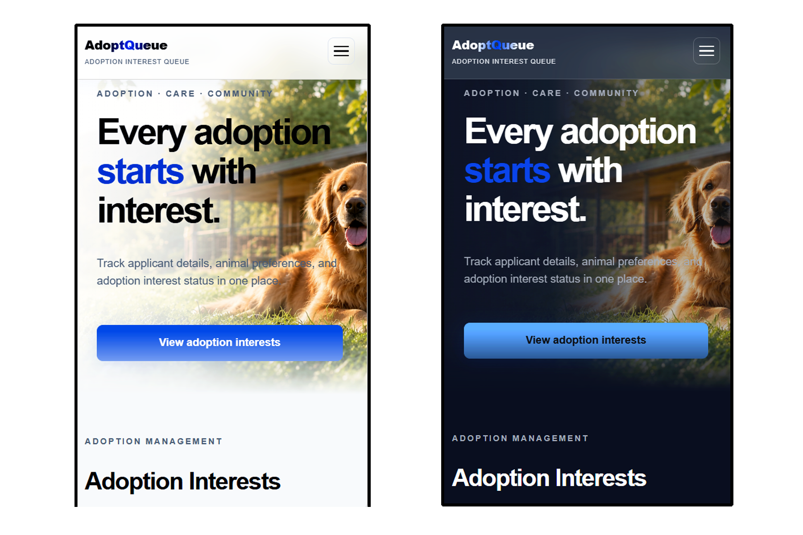
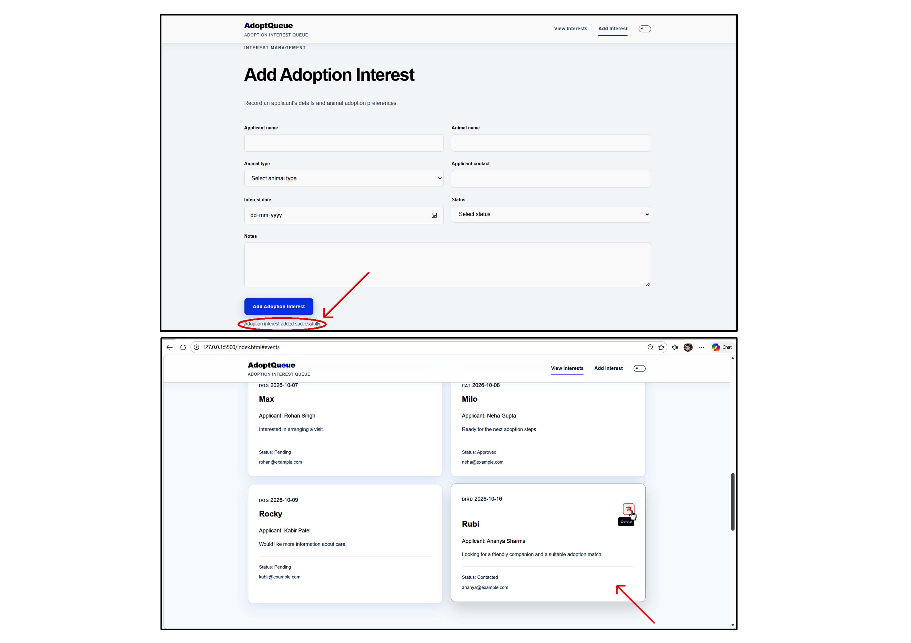
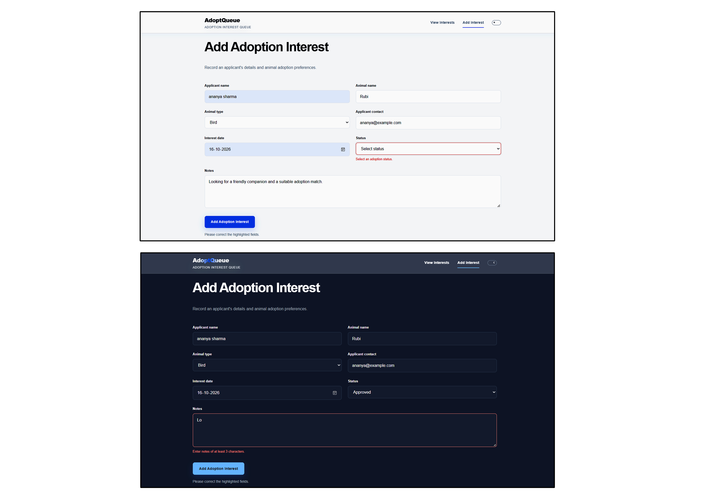
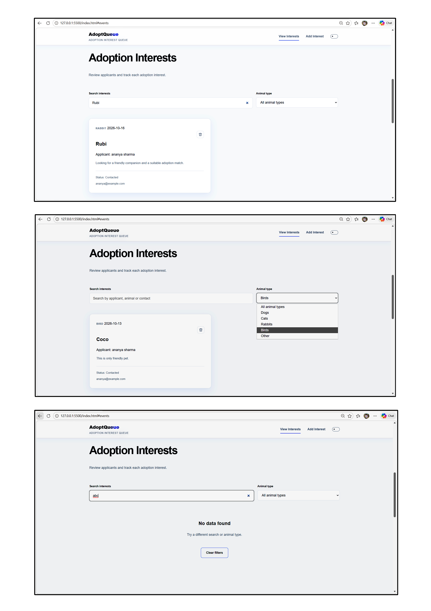

# AdoptQueue — Adoption Interest Queue

A simple and responsive web application built with HTML5, CSS3, and JavaScript to manage adoption interests. It allows users to view, search, filter, add, and delete adoption interest records.

## Live Website

https://adoptqueue.netlify.app

## Features

### Adoption Interest Records:

Displays adoption interest records with applicant name, animal name, animal type, contact details, date, status, and notes.

### Search & Filtering:

Allows users to search adoption records and filter them by animal type.

### Add Adoption Interest:

Users can add new adoption interest records through a form.

### Form Validation:

Checks form fields before submission and displays error messages below invalid fields.

### Data Persistence:

Saves newly added records in localStorage so they remain available after refreshing the page.

### Record Management:

Allows users to delete newly added records while keeping the default records protected.

### Record Count:

Displays the total number of records and updates the count when searching or filtering.

### Empty & Loading States:

Shows a message when no matching records are found. Includes a loading indicator for future use when data loading takes time.

### Theme Support:

Provides Light and Dark mode support for the user interface.

### Responsive Design:

Works on desktop, tablet, and mobile screens with responsive layouts and easy-to-use controls.

### Accessibility:

Includes semantic HTML, form labels, keyboard navigation, visible focus states, and ARIA attributes.

### Security:

Uses text sanitization and HTML escaping to help prevent user-entered content from being treated as executable HTML.

### Error Handling:

Handles invalid saved data and localStorage read/write errors to improve reliability.

### Analytics:

Logs the required user interaction message after a successful adoption interest submission.

## Tech Stack

HTML5 (Page Structure and Form Elements)

CSS3 (Styling, Responsive Layout, and Light/Dark Themes)

Vanilla JavaScript (DOM Manipulation, Form Validation, Search, Filtering, and Record Management)

Browser localStorage (Client-side Data Persistence)

ESLint (JavaScript Code Quality Checks)

## Project Structure

Adoption-Interest-Queue/
├── assets/
│   ├── icons/
│   └── images/
│       └── adoption-hero.png
├── css/
│   └── styles.css
├── js/
│   └── script.js
├── node_modules/
├── public/
│   └── screenshots/
├── .gitignore
├── eslint.config.mjs
├── index.html
├── package-lock.json
├── package.json
└── README.md

## Project Screenshots

### Desktop View:

### Mobile View:

### Adoption Interest Management:

### Form Validation:

### Search & Filtering:

